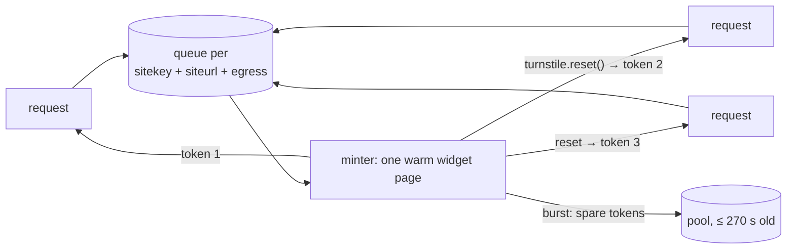

# POST /solve-turnstile

Mint a Turnstile token for a sitekey bound to a domain.

```json
{"sitekey": "0x4AAAAAAA...", "siteurl": "https://example.com/", "timeout": 30, "proxy": null}
```

| Field | Default | Meaning |
| --- | --- | --- |
| `sitekey` | — | `[A-Za-z0-9_-]{1,128}` (it is embedded in the page, so the charset is strict) |
| `siteurl` | — | A URL on the domain the sitekey is bound to. Normalised (lower-case host, default port and fragment dropped) |
| `timeout` | `30` (5–120) | Seconds to wait for a token, queue time included |
| `proxy` | `null` | Egress. Omitted = the default browser (WARP + licensed build when `WARP_PROXY` is set); `"direct"` = server IP; or a proxy URL |

Response: `{"solved": true, "token": "...", "elapsed": 4.5, "pooled": false, "siteurl": "...", "proxy": "http://warp:8080"}`
(`proxy` is the egress actually used, credentials masked, `"direct"` for none).

| Status | Meaning |
| --- | --- |
| `200` | Token minted. `pooled: true` = it was pre-minted (only with `TURNSTILE_PREFETCH` > 0); still single-use and never given to anyone else |
| `422` | Bad sitekey/siteurl/proxy format |
| `502` | Widget error (e.g. `110200` domain not authorized, `400020` invalid sitekey) or browser failure |
| `503` | Browser pool busy, or this sitekey's queue is full (`TURNSTILE_MAX_QUEUE`) |
| `504` | No token within `timeout` |
| `409` | Proxied solving disabled (`MAX_BROWSERS=0`) |

## How it works

The browser opens `siteurl`, but the request is intercepted and answered with a tiny page that renders the widget
explicitly. The page therefore lives on the real origin, so the sitekey's domain binding holds, and nothing is
fetched from the target site.



- **Tokens are single-use and expire after 300 s.** They are never cached for reuse, never written to disk and never
  handed to two callers (the page's token is read-and-cleared).
- **One warm page per sitekey.** After a token, `turnstile.reset()` produces the next one without reopening a
  context. The page stays open for 60 s after the last request, so sequential callers skip the context, page load
  and widget render; it is closed early if other requests are queuing for a browser tab.
- **Queue, oldest first.** Concurrent requests for one sitekey wait for the minter. Past `TURNSTILE_MAX_QUEUE`
  waiters the API answers `503` immediately instead of letting requests pile up.
- **Pre-minting (off by default).** With `TURNSTILE_PREFETCH=N`, after a burst the minter keeps up to N spare tokens
  so the next requests are answered instantly; a spare nobody takes is dropped at 270 s. That costs extra solves
  Cloudflare sees on the sitekey, so leave it at 0 unless requests really arrive in repeated bursts.
- **Serialised per sitekey by default.** Parallel solves on one sitekey from one IP make Cloudflare escalate
  difficulty. `TURNSTILE_MINTERS_PER_KEY` can raise it; measure before you do.
- **Throughput.** One minter delivers roughly 15–30 tokens per minute. Different sitekeys mint in parallel, each on
  its own browser tab.
- **Failure handling.** A configuration error (bad sitekey, unauthorized domain) fails the whole queue at once. Other
  widget errors reset the widget; three failed attempts in a row fail the queue. A minter gives its tab back every
  5 minutes so the browser can still be recycled under constant demand.

## How long a solve takes

Measured live on one real sitekey (2026-10-17):

| Egress | First request (cold browser) | Sequential (warm page) | 3 at once |
| --- | --- | --- | --- |
| Default browser: WARP + licensed build | 9.0 s | 3.4–3.6 s | done in 11.8 s (~3.9 s per token) |
| `"direct"`: keyless build on the server's datacenter IP | — | 11–27 s | done in 27.7 s |

Most of a solve is Cloudflare's own verification after the checkbox click (~3–5 s on the default browser); a cold
browser adds ~3 s once (GeoIP lookup + launch). Cloudflare challenges a keyless browser on a datacenter IP far
harder, which is why the default browser is the default.
