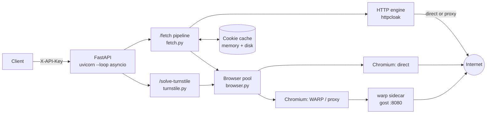
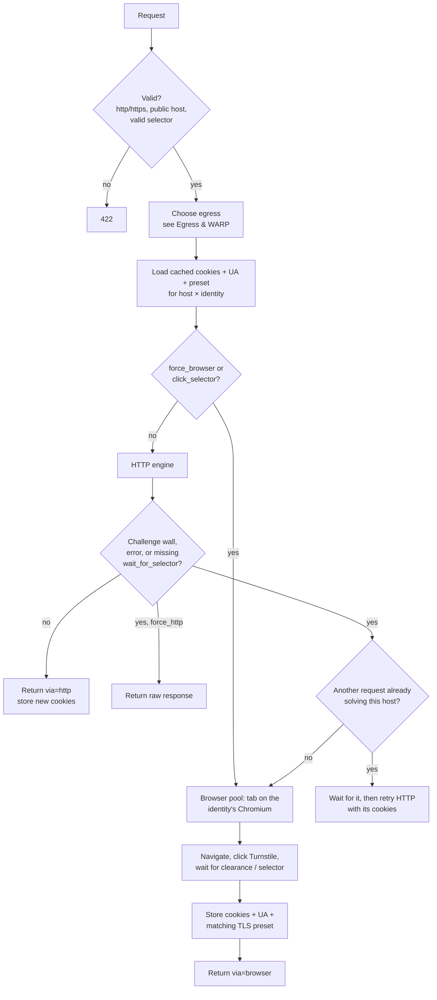
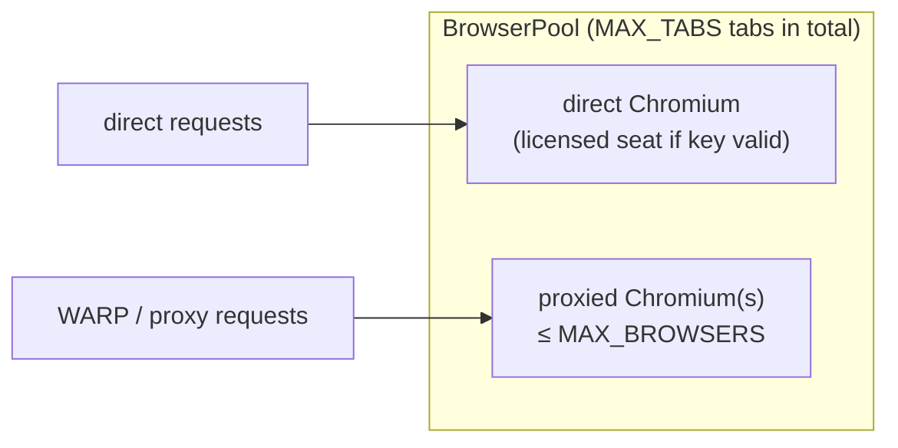

# Architecture

## Components

| Component | Role |
| --- | --- |
| **HTTP engine** (`httpcloak`) | Sends requests with a real browser TLS/HTTP2 fingerprint. Async, cheap (milliseconds, a few MB). Handles the vast majority of traffic. |
| **Browser pool** (`cloakbrowser` = patched Chromium driven by Playwright) | Used only when the HTTP engine meets a challenge, or when forced. Expensive (seconds, ~100–300 MB per process). |
| **Cookie cache** | Remembers the cookies + User-Agent + TLS preset that passed Cloudflare, per host and per egress identity, so the HTTP engine can replay them. Persisted to disk. |
| **WARP sidecar** | `dublok/cloudflare-warp` container exposing an HTTP proxy at `http://warp:8080`. Optional default egress for the browser. |
| **Turnstile minter** | Keeps a warm widget page per sitekey and mints single-use tokens on demand. |

## The life of a `/fetch` request

Key properties:

- **One solve per host at a time.** Concurrent requests for the same host×identity wait for the first browser solve
  (coalescing) and then replay its cookies over HTTP. Requests with `force_browser`, `wait_for_selector` or
  `session_id` are not coalesced because their result is page- or session-specific.
- **Clearance replay matches the browser exactly.** After a solve, the HTTP engine uses the browser's User-Agent and
  the `httpcloak` preset of the **same Chrome major and OS** (e.g. `chrome-146-windows`). A `chrome-latest-*` preset
  would send `sec-ch-ua` for a newer version than the UA claims, and Cloudflare re-challenges that mismatch.
- **A rejected clearance is dropped, app cookies are kept.** If a cached `cf_clearance` stops working, only the
  Cloudflare cookies are invalidated; login/session cookies survive. Network errors never invalidate the cache.

## Browser pool

- **One Chromium process per egress identity** (direct, WARP, or each distinct proxy). CloakBrowser applies proxy,
  timezone, locale and WebRTC IP per process, so a process can only ever represent one IP.
- **`MAX_TABS`** caps open tabs across all processes. **`MAX_BROWSERS`** caps *proxied* processes (WARP counts as
  proxied); the direct browser is outside that budget. When full, the least recently used idle proxied process is
  evicted.
- **Launches and closes never hold the pool lock.** A dead proxy's launch (GeoIP lookups time out through it) cannot
  freeze other identities. A launch has a 90 s ceiling; a close that does not finish in 5 s kills the Playwright driver
  (Chromium exits with its debugging pipe, so nothing is orphaned).
- **Recycling.** Keyless processes are replaced after `BROWSER_MAX_LIFETIME_SEC` idle age, the licensed seat holder
  after `BROWSER_LICENSED_LIFETIME_SEC`. A process whose page call stalls past `BROWSER_CALL_TIMEOUT_SEC` is
  **poisoned**: it takes no new tabs and is replaced once its open tabs finish.
- **Exit-IP watch.** Proxied processes re-check their exit IP every `BROWSER_EXIT_IP_CHECK_SEC`; if it changed, the
  process is retired and every cookie earned through that identity is dropped.
- **Hard job deadline.** A browser job (queue wait included) never exceeds `cf_wait + BROWSER_JOB_OVERHEAD_SEC`.

## What one browser tab does (`fetch_flow.py`)

1. New context, cached cookies injected, custom headers set; non-GET methods rewrite the navigation's method/body.
2. Navigate. Fatal network errors (`ERR_NAME_NOT_RESOLVED`, refused, TLS errors) fail fast with 502.
3. Settle 2.5 s, then loop until the wall is gone (and `wait_for_selector` exists) or `cf_wait` runs out:
   detect fresh `cf_clearance`, reload once if Cloudflare does not redirect by itself, click the Turnstile checkbox
   every 2.5 s. A 429 from the origin past the wall stops the loop early.
4. A Chrome error page (`chrome-error://`) is reported as a failure, never as a solved 200.
5. Optional `click_selector`: wait while disabled, click, then follow navigations/downloads until they settle.
6. Downloads and binary documents are never fetched: the file URL is returned with a note.
7. Harvest body, cookies, UA, redirect chain; close the context.

## Turnstile minting

See [`POST /solve-turnstile`](api/turnstile.md). One minter per (sitekey, siteurl, egress) holds a warm widget page,
calls `turnstile.reset()` for each next token, serves queued requests oldest-first, and pre-mints a few spares during
bursts. Tokens are single-use and never handed to two callers.
