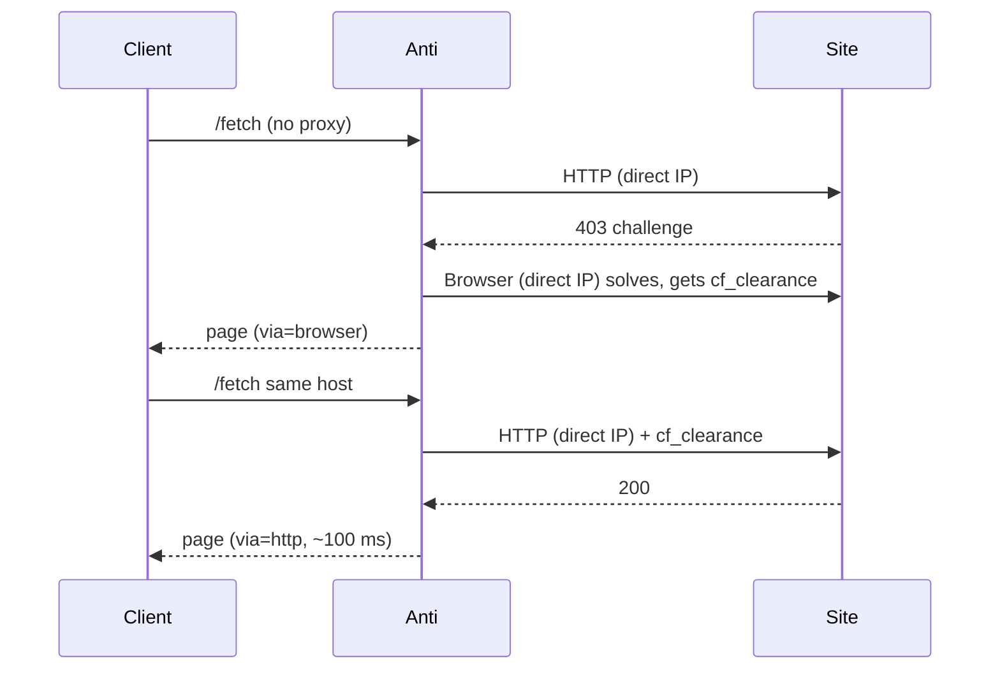
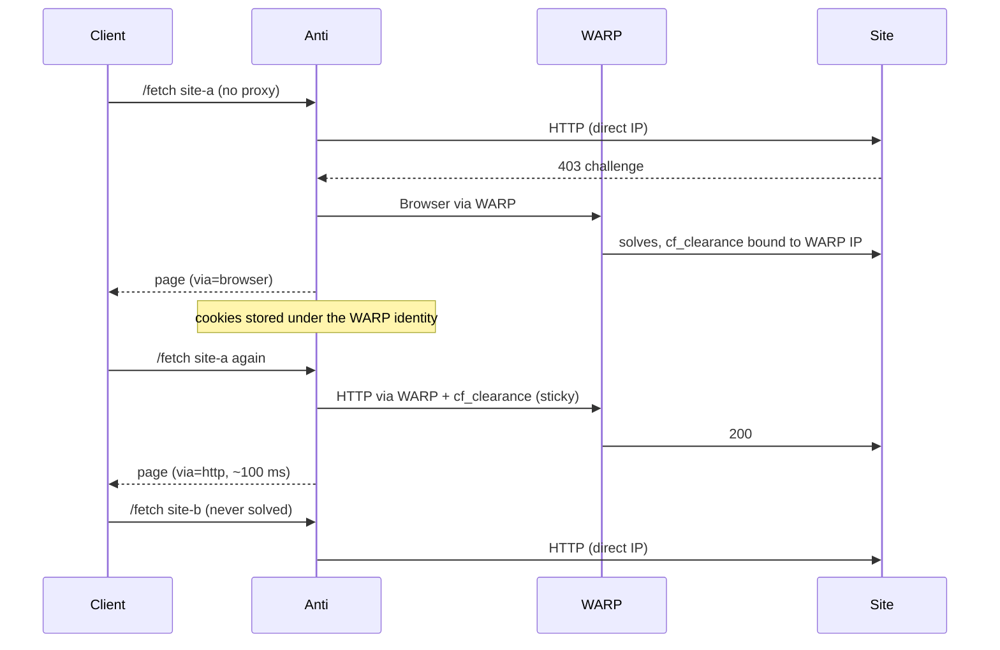

# Egress & WARP

"Egress" is the IP address a request leaves from. It matters because **Cloudflare binds `cf_clearance` to the IP that
earned it**: a clearance solved from IP A is rejected when replayed from IP B, and the site challenges again.

The code calls each egress an **identity**: `direct` (the server's own IP), WARP, or one specific proxy. Every
identity has its own Chromium process and its own cookie namespace (`px-<hash>@host` in the cache).

## The rules

| Request `proxy` field | HTTP engine goes via | Browser goes via |
| --- | --- | --- |
| a proxy URL | that proxy | that proxy |
| `"direct"` / `"off"` | direct | direct |
| omitted, `WARP_PROXY` **unset** | direct | direct |
| omitted, `WARP_PROXY` **set** | direct — **unless** WARP already earned clearance for this host, then WARP | WARP |

An explicit `proxy` always pins both engines. Only requests *without* a `proxy` field use the hybrid below.

## `WARP_PROXY` unset

Everything leaves from the server's own IP. Simple, and fine when the server's IP is not challenged much.



## `WARP_PROXY=http://warp:8080` set

WARP is the **browser's** default egress. The HTTP engine stays direct, because most sites answer direct requests
fine and WARP adds a hop. The single exception is a host whose clearance WARP earned: that clearance only works from
the WARP IP, so that host's HTTP requests follow the browser through WARP ("sticky").



Why "sticky" and not "always WARP" or "always direct":

- **Always direct** would break replay: the clearance came from the WARP IP, the HTTP request would come from the
  server IP, Cloudflare would reject it and every request would fall back to the browser.
- **Always WARP** sends all traffic, including the majority of sites that never challenge, through an extra proxy hop
  with connection limits (see [Troubleshooting](operations/troubleshooting.md#warp-proxy-stops-answering)).

The decision is made per request in `fetch.py`: if a cookie entry exists for `host × WARP identity`, HTTP uses WARP.
When that clearance expires or is rejected, the entry is invalidated and the host goes back to direct HTTP.

The log line on every response tells you what happened:

```text
[PROXY] HTTP egress via direct; browser escalation via http://warp:8080   ← hybrid, host not solved by WARP yet
[PROXY] Egress via http://warp:8080                                       ← sticky: WARP owns this host's clearance
[PROXY] Egress via direct                                                 ← proxy="direct", or WARP_PROXY unset
```

## When WARP is down

There is no silent fallback to direct for a WARP identity (that would change the IP under a clearance and leak the
server IP where a proxy was intended). Browser escalations fail with a proxy error (502) until WARP answers again;
plain HTTP requests are unaffected because they go direct. `/health` shows `"warp": "on" | "off" | "unknown"`.

## Licensing note

The CloakBrowser license seat (if `CLOAKBROWSER_LICENSE_KEY` is valid) goes to the default browser: the direct one,
or the WARP one when `WARP_PROXY` is set. Other proxies always run the keyless build.
